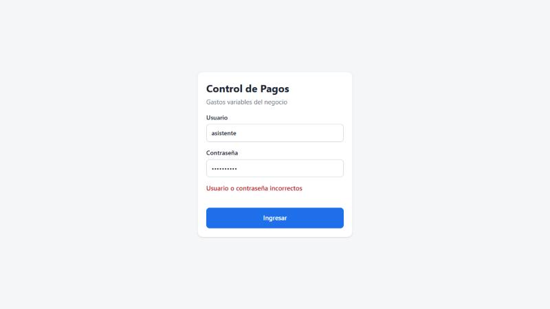
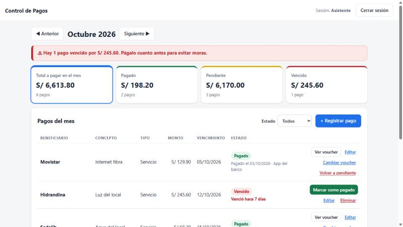
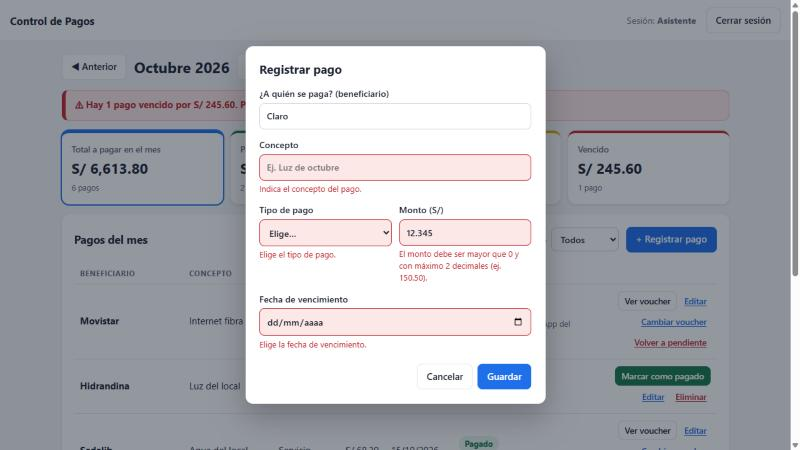
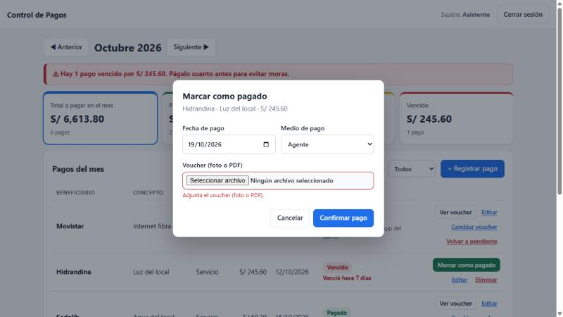
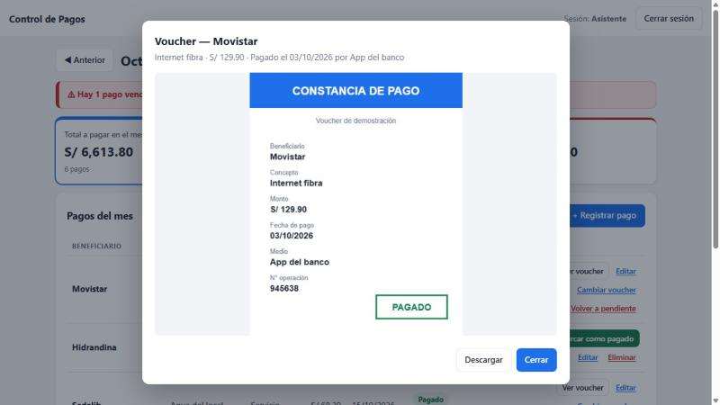
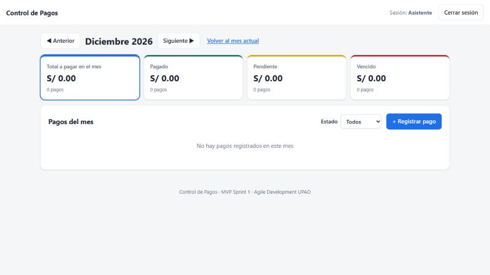
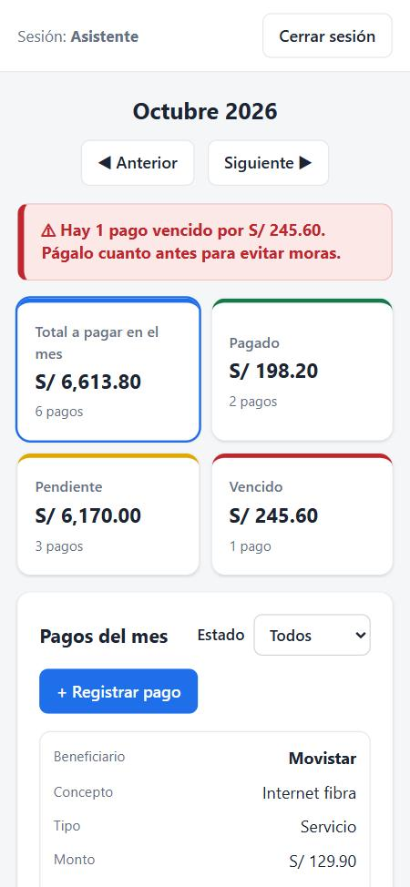

# Checklist de pruebas — criterios de aceptación

**Sistema probado:** https://farashift.github.io/control-pagos/  
**Fecha:** Lunes 19 de octubre de 2026, 19:20 – 19:35  
**Navegador:** Chrome (computadora 1280×720 y celular 375×812)  
**Datos:** se empezó con el navegador limpio (datos de ejemplo del sistema).

## Resultado: 36 de 36 criterios cumplidos ✅

| Historia | Criterios | Resultado |
|---|---|---|
| HU-01 · Iniciar sesión | 5 | ✅ 5/5 |
| HU-02 · Registrar un pago pendiente | 6 | ✅ 6/6 |
| HU-03 · Ver los pagos del mes | 6 | ✅ 6/6 |
| HU-04 · Marcar como pagado con voucher | 5 | ✅ 5/5 |
| HU-05 · Ver el resumen del mes | 5 | ✅ 5/5 |
| HU-06 · Corregir un pago mal registrado | 5 | ✅ 5/5 |
| HU-07 · Consultar meses anteriores | 4 | ✅ 4/4 |

## HU-01 · Iniciar sesión

| # | Criterio | Qué se hizo y qué se observó | ✔ |
|---|---|---|---|
| 1 | Existen solo dos usuarios: uno con rol Gerente y otro con rol Asistente. | Entran solo asistente/asistente123 (sesión «Asistente») y gerente/gerente123 (sesión «Gerente»). admin/admin y las claves cruzadas son rechazadas. | ✅ |
| 2 | Con usuario y contraseña correctos, el sistema entra a la pantalla principal. | Con asistente/asistente123 se muestra el resumen y la lista del mes. | ✅ |
| 3 | Con datos incorrectos, muestra "Usuario o contraseña incorrectos" y no deja entrar. | Aparece exactamente «Usuario o contraseña incorrectos» y se queda en el login. (Evidencia 1) | ✅ |
| 4 | Sin iniciar sesión no se puede ver ninguna pantalla del sistema. | Al abrir el link sin sesión solo se ve el login; no se dibuja ningún pago. Al cerrar sesión vuelve al login. | ✅ |
| 5 | Hay un botón "Cerrar sesión" visible en todas las pantallas. | Barra superior fija: el botón sigue visible al bajar hasta el final, en cualquier mes y en celular. Mientras un formulario está abierto queda detrás de esa ventana (se cierra con Cancelar). | ✅ |

## HU-02 · Registrar un pago pendiente

| # | Criterio | Qué se hizo y qué se observó | ✔ |
|---|---|---|---|
| 1 | El formulario pide: beneficiario, concepto, tipo de pago, monto y fecha de vencimiento. | Campos: ¿A quién se paga? (beneficiario) · Concepto · Tipo de pago · Monto (S/) · Fecha de vencimiento. | ✅ |
| 2 | El tipo de pago se elige de una lista: Servicio, Proveedor, Impuesto o Préstamo. | Lista desplegable con exactamente: Servicio, Proveedor, Impuesto, Préstamo. | ✅ |
| 3 | El monto debe ser positivo, mayor que 0, con máximo 2 decimales. Está en soles (S/). | Rechazados: 0 · -5 · abc · 12.345 · 0.00 · 1.2.3 · vacío. Aceptado: 150.50 → se muestra «S/ 150.50». | ✅ |
| 4 | Si falta un campo obligatorio o el monto es inválido, no se guarda y se muestra qué campo corregir. | Quitando cada campo por separado: no guarda, marca ese campo en rojo con su mensaje (ej. «Indica a quién se le paga.»). Todo vacío: 5 mensajes. (Evidencia 3) | ✅ |
| 5 | Al guardar, queda "Pendiente" y aparece en la lista del mes de su vencimiento. | Registrado con vencimiento 14/11/2026: queda «Pendiente» y la pantalla pasa a Noviembre 2026, donde aparece. | ✅ |
| 6 | Registrar un pago no toma más de 1 pantalla. | Los 5 campos y el botón Guardar están en una sola ventana, sin pasos adicionales. | ✅ |

## HU-03 · Ver los pagos del mes

| # | Criterio | Qué se hizo y qué se observó | ✔ |
|---|---|---|---|
| 1 | Al entrar, se muestran por defecto los pagos del mes actual. | Al iniciar sesión abre «Octubre 2026» (mes actual) sin filtros, aunque antes se haya navegado a otro mes. (Evidencia 2) | ✅ |
| 2 | Cada pago muestra: beneficiario, concepto, tipo, monto, fecha de vencimiento y estado. | Columnas: Beneficiario, Concepto, Tipo, Monto, Vencimiento, Estado. Ej.: SUNAT · IGV mensual · Impuesto · S/ 1,850.00 · 22/10/2026 · Pendiente. | ✅ |
| 3 | Los estados son Pendiente, Pagado y Vencido, cada uno con un color distinto. | Pendiente amarillo, Pagado verde, Vencido rojo. | ✅ |
| 4 | Un pago pendiente cuya fecha ya pasó cambia solo a "Vencido". | Hidrandina (vence 12/10) y un pago registrado con vencimiento de ayer aparecen como Vencido sin que nadie los cambie. | ✅ |
| 5 | La lista está ordenada por fecha de vencimiento: lo más próximo primero. | Orden observado: 05/10 → 12/10 → 15/10 → 18/10 → 22/10 → 25/10 → 28/10. | ✅ |
| 6 | Se puede filtrar la lista por estado. | Filtro Vencido: 2 · Pagado: 2 · Pendiente: 3 · Todos: 7. Cada filtro muestra solo ese estado. | ✅ |

## HU-04 · Marcar como pagado con voucher

| # | Criterio | Qué se hizo y qué se observó | ✔ |
|---|---|---|---|
| 1 | Cada pago pendiente o vencido tiene un botón "Marcar como pagado". | Los 6 pagos pendientes/vencidos tienen el botón; los pagados no. (Es una acción de la asistente.) | ✅ |
| 2 | Se pide: fecha de pago, medio (Agente, App del banco, Efectivo o Tarjeta) y voucher (imagen o PDF). | Ventana con fecha de pago, medio (Agente, App del banco, Efectivo, Tarjeta) y archivo que acepta imagen o PDF. | ✅ |
| 3 | No se puede marcar como pagado sin adjuntar el voucher. | Sin archivo la ventana no se cierra, muestra «Adjunta el voucher (foto o PDF).» y el pago sigue sin pagar. (Evidencia 4) | ✅ |
| 4 | Al confirmar, el estado cambia a "Pagado" y se guarda la fecha de pago. | Hidrandina pasa a «Pagado» con «Pagado el 17/10/2026 · Agente» (la fecha elegida). | ✅ |
| 5 | Desde el pago se puede abrir y ver el voucher adjunto. | «Ver voucher» abre la imagen y también un PDF, con botón Descargar. (Evidencia 5) | ✅ |

## HU-05 · Ver el resumen del mes

| # | Criterio | Qué se hizo y qué se observó | ✔ |
|---|---|---|---|
| 1 | Muestra total a pagar en el mes, total pagado, pendiente y vencido, en soles. | Tarjetas: Total a pagar en el mes · Pagado · Pendiente · Vencido, todas en S/. | ✅ |
| 2 | Muestra cuántos pagos hay en cada estado. | Ej.: Total 8 pagos · Pagado 3 · Pendiente 4 · Vencido 1 (coinciden con la lista). | ✅ |
| 3 | Si hay pagos vencidos, aparece un aviso destacado con la cantidad. | «⚠ Hay 1 pago vencido por S/ …». En un mes sin vencidos el aviso no aparece. | ✅ |
| 4 | Los totales se actualizan en cuanto la asistente registra o marca un pago. | Misma pantalla: total +S/ 100 al registrar y Pagado +S/ 100 al marcarlo. Gerente en otra pestaña: su total pasó de S/ 6,864.30 a S/ 7,114.30 apenas la asistente registró. | ✅ |
| 5 | Los totales coinciden con la suma de los pagos de la lista del mes. | Cada tarjeta = suma exacta de la lista (total y por estado) en Septiembre, Octubre y Noviembre. | ✅ |

## HU-06 · Corregir un pago mal registrado

| # | Criterio | Qué se hizo y qué se observó | ✔ |
|---|---|---|---|
| 1 | Un pago pendiente se puede editar (monto, fecha, beneficiario, concepto, tipo) o eliminar. | Editar cambió los 5 datos del mismo pago (no crea otro). Eliminar lo quitó de la lista. | ✅ |
| 2 | Antes de eliminar, el sistema pide confirmación. | Aparece «¿Eliminar este pago?». Con Cancelar o Escape no se borra. | ✅ |
| 3 | En un pago pagado se puede reemplazar el voucher equivocado. | «Cambiar voucher» pide solo el archivo; el voucher se reemplazó y el pago sigue Pagado con su fecha. | ✅ |
| 4 | Un pago marcado como pagado por error se puede volver a "Pendiente", con confirmación. | Pide «¿Volver este pago a Pendiente?». Cancelar no cambia nada; al confirmar queda sin pagar y sin voucher. | ✅ |
| 5 | Las ediciones siguen las mismas validaciones de la HU-02. | Al editar se rechazan monto 0, 12.345 y abc, y beneficiario/concepto/fecha vacíos. El pago no cambia. | ✅ |

## HU-07 · Consultar meses anteriores

| # | Criterio | Qué se hizo y qué se observó | ✔ |
|---|---|---|---|
| 1 | Hay botones para ir al mes anterior y al mes siguiente. | Botones «◀ Anterior» y «Siguiente ▶» arriba del resumen. | ✅ |
| 2 | Al cambiar de mes, la lista y el resumen muestran solo los pagos de ese mes. | Septiembre: 6 pagos, todos de 09/2026. Noviembre: solo 11/2026. El resumen cambia con el mes. | ✅ |
| 3 | Si un mes no tiene pagos, se muestra "No hay pagos registrados en este mes". | Diciembre 2026: se muestra el mensaje exacto y el resumen en S/ 0.00. (Evidencia 6) | ✅ |
| 4 | Siempre se ve el nombre del mes y año (ej.: Octubre 2026). | Diciembre 2026 → Enero 2027 → Agosto 2026 → Octubre 2026: siempre visible, también al cambiar de año. | ✅ |

## Mejoras adicionales

| Mejora | Qué se observó | ✔ |
|---|---|---|
| Aviso de días | Hoy 19/10: «Vence hoy», «Vence mañana», «Vence en 3 días» (amarillo), «Vence en 11 días», «Venció ayer», «Venció hace 9 días» (rojo). Los pagados no lo muestran. | ✅ |
| Editar un pago ya pagado | Movistar: monto 129.90 → 149.90 y concepto corregido; sigue Pagado con el mismo voucher, fecha y medio. | ✅ |
| Gerente solo consulta | No ve «+ Registrar pago»; su único botón es «Ver voucher»; no hay botón de reiniciar y el link #reiniciar no hace nada con su sesión. | ✅ |
| Reinicio solo para la asistente | Con la sesión de la asistente, el link …/#reiniciar pide confirmación y deja los 12 pagos de ejemplo. | ✅ |
| Formatos de monto | «1,850» → 1850 · «1,850.50» → 1850.50 · «150,50» → 150.50 · «S/ 99» → 99. | ✅ |
| Celular | Ancho 375 px: sin desplazamiento horizontal; la tabla se ve como tarjetas y los formularios entran en pantalla. (Evidencia 7) | ✅ |

## Evidencias

**1. HU-01: datos incorrectos**

**2. HU-03 / HU-05: pantalla principal del mes actual**

**3. HU-02: campos que faltan corregir**

**4. HU-04: el voucher es obligatorio**

**5. HU-04: ver el voucher adjunto**

**6. HU-07: mes sin pagos**

**7. Vista en celular**

